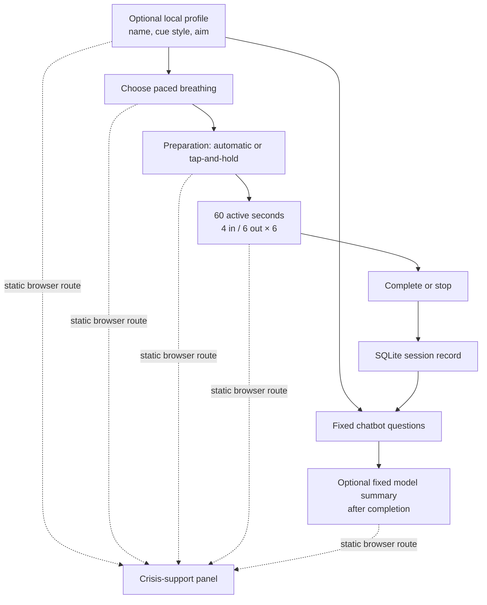

# Stillpoint design and safety note — Assignment 3

## Implemented experience

Part 3.2 implements one coherent study-provided skill: **paced breathing (4–6)**. The person chooses the practice, chooses either automatic visual timing or tap-and-hold pacing, then follows six cycles of four seconds in and six seconds out. Releasing the tap-and-hold control pauses the current count; automatic timing has a pause button. An end/leave control is present before and during the exercise. Completion is never required.

The proposed 5–4–3–2–1 grounding design from Part 3.1 is intentionally deferred. It is not shown as an available skill, so the running interface does not claim to support it.

## Research grounding and tradeoffs

| Finding | Implemented decision | Tradeoff |
| --- | --- | --- |
| R1: attention fell after 90–100 seconds; ~60 seconds felt comfortable (38 mentions) | Six 4+6 cycles take 60 active seconds, measured from the first “Breathe in” cue through the final cycle. Setup precedes the measurement; a voluntary pause is excluded. | A single short practice respects attention but offers less variety. |
| R2: frictionless crisis access (30) and D4: persistent safety (31) | A fixed Vue button opens static support information; it does not request FastAPI or rely on a model/classifier decision. | The U.S.-specific resource must be checked when updated; the app itself does not provide crisis care. |
| R3: permission to stop (39) and R4: user control (68) | Preparation and active practice each offer leave/end controls without confirmation or explanation. History records stopping as a neutral outcome. | The session may be brief, by design. |
| D1: progressive contraction (54) | The prototype does not infer distress. It gives everyone a low-stimulus baseline: one practice, one primary action, short text, and no in-practice dashboard. | It cannot claim personalized contraction. |
| D2: one atomic skill at a time (100) and D3: minimize emotional cost (148) | The active screen provides only the count/cue plus pause/end controls. The person chooses automatic timing or a tap-and-hold control without changing the sequence. No disclosure, rating, or written response is needed to finish. | It collects less individual context and does not offer additional breathing patterns. |
| D5: personalization without configuration burden (49) | The latest completed practice is offered as an optional repeat shortcut, not an automatic route. An optional profile can set a display name, cue style, and practice aim; it is editable and resettable. | A small profile makes personalization demonstrable while avoiding health, mood, or inferred-state data. |
| D6: low-stimulus, non-judgmental language (97) | Muted colors, restrained motion, native keyboard controls, and `prefers-reduced-motion` support keep the cue readable without clinical or cheerful pressure. | The visual treatment is intentionally simple. |

## Chatbot boundaries

The coursework chatbot has fixed buttons rather than free-text input. Seven website questions are local and deterministic. After a completed fictional practice, one explicit “Create a brief practice summary” button may call the backend model. Its context contains only the completed session’s skill/timing, selected cue/aim choices, and completed-practice count; it never includes a display name, journal entry, typed disclosure, crisis text, or an LLM key. The selected prompt/reply pair is saved locally so it can be reviewed in history.

The model may return one factual, neutral sentence under 120 characters. Backend validation rejects diagnostic, therapeutic, medical, crisis, directive, or overlong output and saves a local fallback if the model is unconfigured, fails, or is unsafe. The chatbot cannot change the breathing sequence, operate the timer, select a skill, prevent an exit, write SQLite directly, or provide the crisis route. It does not claim therapeutic authority, diagnosis, medical expertise, or crisis care. The independent browser support panel remains available whether FastAPI or the model succeeds or fails.

## Persistent records

`user_profile` stores at most an explicit optional display name (24 characters), selected cue style (`brief` or `step_by_step`), selected practice aim (`one_short_practice` or `review_pattern`), and update timestamp. The person may edit or reset all fields. `skill_sessions` stores an opaque ID, `paced_breathing`, source (`chosen` or `usual_skill`), outcome (`active`, `completed`, or `stopped`), active seconds, and timestamps. `conversation_messages` stores only the selected fixed model-summary prompt, the returned/fallback reply, model identifier, session ID, and timestamp. The history view displays the newest 12 sessions and 12 selected-summary messages. There is no account, score, diagnosis, location, inferred distress level, free-text chatbot input, or stored potential-crisis text.

`journal_entries` stores only an explicit optional fictional journal body (maximum 500 characters) and timestamp; the Journal page shows the latest 12. It is a separate local record: journal text is never sent to the chatbot or model and cannot influence the fixed skill, profile, or personalization. A narrow phrase rule prevents limited potential-crisis wording from being saved, just as it prevents that text from reaching the chatbot. It is a routing guard, not a distress detector.

## Observed timing and scope change

In the October 15 browser check, a full practice completed with **60 active seconds**. A leave-before-begin path recorded `stopped` with **0 seconds** and appeared in history. On November 2, the current build used fixed local questions plus a selected model-summary button: two no-profile 60-second fictional summaries returned different provider/model outputs that stayed factual and within the local output checks. Details are in [the verification record](assignment3-verification.md) and [evaluation](assignment3-evaluation.md).

5–4–3–2–1 grounding remains deferred. The 15-scenario evaluation is documented, while peer usability testing and the required finished-demo/process recordings remain intentionally unclaimed until recorded.
