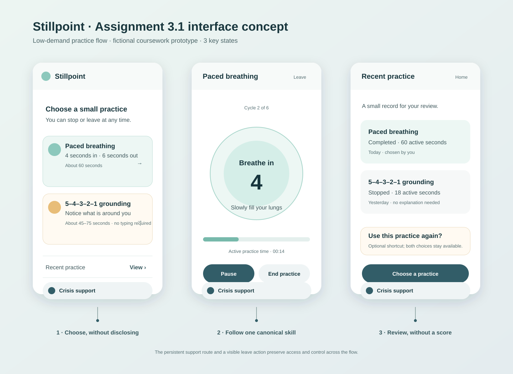
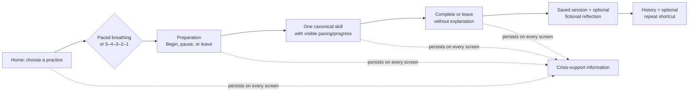

# Stillpoint — Assignment 3.1 research and interface design

Stillpoint is a **localhost-only coursework prototype for fictional scenarios**. It is not therapy, diagnosis, monitoring, crisis care, or a service that anyone should rely on while distressed. This document is the Part 3.1 design checkpoint; it proposes an experience and does not claim that the application has been built.

## Main experience

The proposed home screen presents two study-provided skills without asking someone to explain why they arrived:

1. **Paced breathing (4–6).** A preparation screen leads to six cycles of four seconds in and six seconds out. The active exercise is 60 seconds from the first “Breathe in” cue to the final exhale. Setup is separately estimated at 10–15 seconds. A pause stops the active timer, and a leave action is available before and during the practice.
2. **5–4–3–2–1 sensory grounding.** The screen presents the canonical sequence—five things seen, four felt, three heard, two smelled, one tasted—as short optional prompts. It does not require typed answers. The intended read-and-notice pace is 45–75 seconds; any pause or time spent opening support information is outside that estimate.

The visual design uses one primary action, muted contrast, short instructions, and a clearly persistent **Crisis support** control. That control opens static support information in the browser; it must remain available without a model, an API request, or a classifier decision. The prototype would label the resource information by country/region and keep it separate from the exercise flow.

## Design decisions grounded in the supplied study findings

| Finding | Design decision | Gain and tradeoff |
| --- | --- | --- |
| **R1**: attention declined after 90–100 seconds | Keep either planned exercise at or below 75 seconds; paced breathing is designed for 60 active seconds. Setup is outside the exercise measure, and voluntary pauses never expire the person out of the flow. | A short practice reduces sustained attention cost; it provides less time for repetition or detail. |
| **R2**: participants wanted easy crisis access | Keep a labelled browser-local support route fixed in the layout. It does not wait for a concerning message, model classification, or backend response. | It is consistently visible, but its information must be checked and localized rather than inferred. |
| **R3/R4**: participants valued permission to stop and control | Include leave/end controls before and during a skill, with no explanation or confirmation required. A stopped session is neutral rather than a failure. | A person can end quickly; the app cannot assume that a started skill was completed. |
| **D1**: do not assume reliable distress detection | Do not infer a distress level or adapt based on typing, timing, or a classifier. Start everyone with the same low-demand design and visible choice. | Avoids a false clinical claim; it cannot automatically simplify based on an unobserved state. |
| **D2/D3**: one atomic skill and lower emotional cost | Put only the current canonical step, simple count/progress, and control buttons on the active screen. No rating or written reflection is needed to finish. | Lower effort and fewer stored details; less individualized context. |
| **D5**: personalization without a configuration burden | After a completed session, offer the most recently completed skill as an optional “Use this practice again” shortcut. Keep both skills visible and do not auto-route anyone. | Saves one choice for a returning person while preserving control; it learns no preference profile. |
| **D6**: restrained, non-judgmental presentation | Use quiet colors, plain wording, keyboard-reachable controls, and a reduced-motion alternative to an expanding/contracting breathing cue. | The interface is intentionally understated rather than highly animated or gamified. |

## Model contribution and limits

The model is proposed as an optional, bounded companion after—not during—a completed skill. It may receive only a skill identifier, the completion state, and an explicitly voluntary **fictional** note. Its job is limited to a short neutral acknowledgment. The application, rather than the model, controls the exact skill steps, timing, choice of skill, pause/leave actions, saved records, and support route.

The backend would reject overlong, diagnostic, therapeutic, medical, directive, or crisis-language output and display a fixed local acknowledgment instead. A narrow input phrase check may prevent limited potential-crisis text from being retained or sent to the model, but it must be documented as an imperfect routing rule—not a distress detector. Static support information remains available whether the model succeeds, fails, or is unavailable.

## Proposed records and review

SQLite is planned to store only the information necessary to provide a small history and the optional shortcut:

| Record | Fields | Purpose / boundary |
| --- | --- | --- |
| `skill_sessions` | opaque session ID, skill ID, source (`chosen` or `usual_skill`), outcome, active seconds, created/completed timestamps | Shows a concise practice history and allows the optional last-completed-skill shortcut. No account, diagnosis, score, location, or inferred state. |
| `conversation_messages` | opaque message ID, session ID, role, explicit optional fictional note or bounded acknowledgment, model identifier, timestamp | Makes the voluntary companion exchange reviewable. Potential-crisis content is not stored verbatim or transmitted. |
| browser-local support panel | no stored input | Provides an independent route to static support information on every screen. |

The history view would show the recent skill, outcome, active time, date, and any explicitly optional fictional note/acknowledgment. It would not turn session history into a score, a progress judgment, or a prediction.

## Alternatives considered and unresolved questions

- **Two skills versus one at the first build.** The design keeps both paced breathing and grounding visible to preserve choice. If implementation time is constrained, paced breathing is the first complete vertical slice because its time and visual cue are straightforward to verify; grounding remains a documented, not hidden, planned skill.
- **Typed grounding responses versus no required input.** Requiring five written answers could make the sequence auditable, but it adds reading, typing, and saved sensitive detail. The proposed design uses optional private noticing instead.
- **Automatic personalization versus an optional shortcut.** A default route would reduce one click but could override intent. The proposed shortcut is visible, optional, and reversible by choosing either skill.
- **Open question.** Before implementation, verify in the target browser that the visual breathing cue remains understandable with `prefers-reduced-motion`; the text count must still carry the pace when motion is reduced.

## Reuse and next checkpoint

The future implementation will reuse the course’s Vue/FastAPI/SQLite split: Vue owns visible flow and controls, FastAPI owns persistence and optional model calls, and SQLite owns the limited reviewable records. It will not reuse the prior travel-domain data, map, booking, or hotel-search claims.

Part 3.2 must implement and verify at least one complete skill, persistence, the bounded model contribution, measured timing, voluntary exit, and the independent support route. Part 3.3 must add the required fictional-scenario evaluation, behavior checks, model-variation comparison, and demonstration/process recordings.
