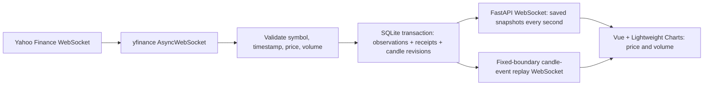

# Assignment 4.1 design

## Scope and data flow

One backend subscription covers AAPL, MSFT, BTC-USD. Price ticks form UTC one-minute OHLC candles. Open/close follow **source-time order**, not network arrival. Missing minutes remain gaps. The backend starts ingestion at startup; closing the browser does not stop persistence. The browser renders only committed data. `frontend/src/stillpoint.js` preserves Assignment 3 at `/stillpoint`; [its prior design](assignment3-design.md) still applies there.

## SQLite schema (user_version 1)

| Table | Identity / stored fields | Purpose |
|---|---|---|
| `observations` | integer `id`; `identity`, `revision` unique together; symbol, source, source_time, received_at, price, nullable day_volume, SHA-256 fingerprint, canonical JSON payload | Immutable accepted source revisions. Identity = `yahoo:symbol:source_timestamp_ms`. |
| `receipts` | integer arrival `id`; observation_id, received_at, disposition | Every valid receipt, including duplicates; dispositions: new, duplicate, revision, out_of_order. |
| `candle_events` | integer arrival `id`; symbol, UTC-minute time, revision, received_at, reason, candle JSON; unique symbol/time/revision | Immutable full candle states. JSON includes OHLC, volume, volume_known, complete, observations count, latest source time and source. |

Each accepted tick uses `BEGIN IMMEDIATE`: commit raw revision, receipt, and affected candle states atomically. WAL and SQLite's transaction locking allow local HTTP reads while writes commit. `MarketStore.initialize()` creates tables/indexes idempotently. DB path is separate from the earlier assignments; generated DB/WAL files are ignored. No market API key is needed. Root `.env` is the only credentials location.

## Duplicate, revised, and out-of-order handling

- Same identity + same payload as its latest revision: record a duplicate receipt; no new raw revision, candle change, or volume addition. A changed payload for that identity creates revision N+1, keeping earlier revisions. An A→B→A payload sequence records three revisions: the last is a new correction, not silently discarded.
- Yahoo supplies no unique exchange trade ID or correction sequence. Timestamp identity is a documented prototype assumption: different messages in the same millisecond are treated as revisions. We cannot prove whether an older payload received later is a correction or stale retransmission.
- A new identity older than the latest source timestamp is marked out_of_order. Recompute from the latest revision of every identity in source-time order. A late tick may revise old OHLC and the following candle's volume baseline. Revision receipts can also arrive late; all receipt times and previous states remain available.
- UTC-minute end is checked every second using server wall time, even if no new tick arrives; a changed completion flag is saved as an `interval_closed` event. Later observations can revise closed candles, which stay closed. Closed means the interval elapsed, not complete market coverage. Replay uses the saved flag as it was then; it does not recompute it using today's clock.

## Volume and honesty about coverage

Yahoo's `day_volume` is a cumulative counter, not tick size. First value establishes a baseline. Nonnegative differences within the same UTC day are assigned to the receiving tick's minute. Missing volume is unknown; a decrease/day change starts another baseline. We never sum cumulative values, use `last_size` as trade volume, or invent volume for missing observations. Zero denotes an observed unchanged counter, distinct from unknown.

This is a best-effort observed-volume delta: changes across missing intervals land in the next received minute; UTC boundaries can differ from exchange sessions. BTC-USD's field can be a rolling USD volume counter, whose changes are not a traded BTC quantity. Premarket stock messages may omit volume entirely. Both the interface and this document label these limitations. Full exchange-quality OHLCV would require additional historical reconciliation and session-aware market metadata, beyond this prototype.

## Replay and APIs

- `GET /api/market/candles?symbol=AAPL`: latest saved state, last 300 minutes with observations, feed stats.
- `GET /api/market/observations?symbol=AAPL&after=0&limit=100`: raw immutable revisions, source and receipt timestamps, stats (max 500/page).
- `GET /api/market/events?symbol=AAPL&after=0&through=N`: event pagination (max 1000/page); retain the returned boundary for repeatable reads.
- `WS /api/market/ws?symbol=AAPL&mode=live`: snapshot, stats and feed state every second, not HTTP polling.
- `WS /api/market/ws?symbol=AAPL&mode=replay&speed=10`: captures highwater N once; starts empty and sends every saved candle event with ID ≤ N in receipt order. Playback speed is events/sec (1–50), not original time spacing. Frontend applies full states by candle time and sorts by source interval; corrections can change earlier candles. It does not write back or consume events created after N.
- `POST /api/market/feed {"enabled":false}`: deliberate local feed disconnection; true reconnects. Not exposed to an external network.

Live ingestion can continue during replay. Replay final state equals SQLite's latest state **at the captured boundary**, not necessarily the later live state. JSONL import is a development reconstruction of original tick receipts, not an exact copy of every idle-clock completion event; exact replay of an existing DB uses `candle_events`.

## Failures, access, and limits

Feed states: connecting, live, stale, unavailable. A connected socket with no recent symbol receipt or source older than 30s is stale; a 45s total-observation timeout reconnects. Feed failures retry after 5s. Browser disconnect is a separate backend-offline status with a 3s reconnect. Saved data is not relabeled live. No prices are synthesized on failure. Python.org macOS CA failures were fixed by supplying installed certifi's trusted bundle while retaining verification.

Chart has a keyboard-accessible equivalent table, labeled controls, visible focus, responsive layout and no required animation; reduced motion is preserved. The former skill UI keeps its static support panel. The chart font has a system fallback.

Limits: one local user/process; no authentication, exchange entitlement, guaranteed timeliness, exact trade identity, historical backfill, automatic retention, or high-throughput claim. Aggregation recomputes the symbol's recorded history for clarity and correctness; growth will require indexed incremental repair/retention. DB writes are synchronous on the event loop, suitable only for this low-rate coursework stream. Browser displays the latest 300 observed minutes while replay/DB retains all revisions. Server clock correctness affects age/completion. This part adds no indicators, trading, model calls, or backtesting.
