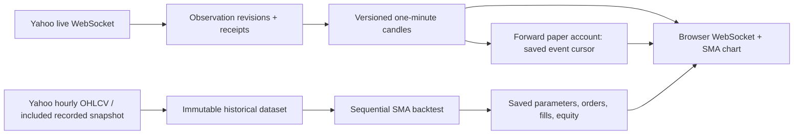

# Market workstation design — Parts 4.1 and 4.2

## Boundaries and data flow

Vue owns display, keyboard controls, chart navigation and visible simulation choices. FastAPI owns Yahoo access, SQLite, confirmed strategy logic, paper accounts and historical backtests. All trades are simulated. No broker or new LLM call exists. Stillpoint remains separately preserved at `/stillpoint`; its skill/crisis-panel/data boundaries are unchanged. [Archived Part 4.1 design](assignment4-part1-design.md) details raw observation identity, late revisions and replay.

## SMA and crossover rules

SMA(N) = arithmetic mean of the last N **completed observed-bar closes**, not N clock intervals. Default short=5, long=20; 2 ≤ short < long ≤ 100. Initial values are absent until a complete window exists. No crossover is inferred from the first available pair. A BUY occurs when the previous fast-minus-slow ≤ 0 and the new difference > 0; SELL uses previous ≥ 0 and new < 0. Values within max(1e-10, 1e-12 × scale) are treated as equal. This adjacent-bar equality convention is explicit: touching equality and departing can produce a repeated-side signal, which position constraints can skip.

`IncrementalSMA` keeps a bounded deque and Decimal rolling sums. The independent batch implementation uses `math.fsum` over slices; tests compare both with pandas `rolling(N, min_periods=N).mean()` and shifted vectorized crosses. Vue implements the same confirmed/preview rule for chart and replay display; two Node tests check published values, known crossover indices and incomplete previews. Confirmed lines may reflect later data revisions; executed paper decisions retain the information originally processed.

An unfinished candle is previewed on a copied indicator state. Its values and markers are labeled provisional; it never advances confirmed history or creates an order. Backtests exclude unfinished bars completely, including their price as a mark or fill. Live paper processing consumes the first closed state for each increasing candle time; late revisions to already processed closed bars remain in the market audit tables but never revise prior fills.

Primary references: [TradingView SMA formula/example and crossover definitions](https://www.tradingview.com/support/solutions/43000502589-moving-averages/), [pandas rolling-window documentation](https://pandas.pydata.org/docs/reference/api/pandas.Series.rolling.html). The published 3-period example [5,6,7,8,9] produces [6,7,8] after warm-up. Numerical agreement does not validate profitability.

## Simulation and accounting

Defaults are $10,000 initial cash, $1 fee per filled order and 5 basis points adverse slippage. Parameters and assumptions are retained with each run. One instrument, long-only, one position, no margin/shorting. BUY while holding and SELL while flat are skipped, with a reason. Fractional units are allowed for all symbols as a coursework assumption.

- Fill price = raw price × (1 + slippage/10,000) for buys; × (1 − slippage/10,000) for sells, quantized to 8 decimal places.
- Buy units = floor-to-6-decimals((cash − fee)/fill price), using Decimal and ROUND_DOWN. All affordable cash is allocated; positive rounding residue remains as cash. No partial execution, volume cap or liquidity model exists.
- Entry cost basis = units × buy fill price + entry fee; cash decreases by that amount. A single position means no lot-selection ambiguity.
- Net sell proceeds = units × sell fill price − exit fee. Realized P/L = net proceeds − entry cost basis. A full sell sets units and basis to zero. An exit whose gross value cannot cover its fee is skipped.
- Market value = units × latest processed price. Unrealized P/L = market value − remaining cost basis. Equity = cash + market value; total P/L = realized + unrealized = equity − initial cash. Entry fees are already in unrealized P/L while holding.
- Return = (equity / initial cash − 1) × 100. Maximum drawdown is the largest peak-to-trough equity loss across **completed-bar marks**, not an intrabar estimate. Closed trades count sells; no forced final liquidation. UI money rounds to cents; API/SQLite preserve underlying precision.

Known example: $1,000 cash, zero slippage, $1 per fill. Buy at $100 gives 9.99 units, zero cash, $1,000 cost basis. At a $110 mark, equity=$1,098.90 and unrealized P/L=$98.90. Sell at $120 yields $1,197.80 cash and $197.80 realized P/L after both fees. Tests verify this exactly and check identities with nonzero slippage.

## Historical backtesting: causal order of events

`backtest()` visits unique, increasing bar timestamps. Before examining bar t's close, it fills any order queued by an earlier completed bar using t's open. It then marks at t's close, advances the SMAs, creates an order if a new crossover exists, and records equity/drawdown. A last-bar order stays pending if no later bar exists. An earlier SELL while flat is retained as skipped. Gaps use the **next available** open, potentially after an overnight/weekend gap; fees/slippage apply there.

Historical data comes from `yfinance.Ticker.history(period='1mo', interval='1h', auto_adjust=False, actions=False, prepost=False)`. Only intervals whose conservative start+1h ≤ fetch time are retained, so shortened session-final bars may become eligible later than their actual close. All OHLC values, ordering, completion and volume are validated. Dataset content includes source, symbol, interval, bars and a SHA-256 identity; original fetch time is preserved on deduplication. Historical datasets do not masquerade as new live observation receipts.

The included AAPL sample is a real recorded Yahoo response, explicitly loadable without the network. Fetch failure returns HTTP 503; no automatic mock/sample fallback. Run parameters, dataset identity and complete results are immutable. Reopening a saved run restores its parameters and dataset into the chart. The chart displays up to 300 bars; this month's AAPL sample has 161 bars, so its entire backtest is visible.

Prefix-invariance tests verify that extending/mutating future bars cannot alter earlier signals/equity. This prevents strategy look-ahead within the supplied dataset. It does **not** make the retrieved data point-in-time: Yahoo may have corrected past prices before fetch. Unadjusted prices, splits, uncredited dividends, missing bars, fixed fees/slippage and zero liquidity constraints limit economic realism. The chosen surviving symbol omits delisted instruments (**survivorship bias**). Changing windows after inspecting this sample risks **overfitting**; defaults were chosen before running it, with no parameter search. No out-of-sample robustness or future performance is established; a positive return is not a completion criterion.

## Forward paper account

Starting a paper account atomically captures the market event boundary and seeds SMAs from up to 300 latest closed candles. Seeding places no historical orders or historical equity points. A second active start for the same symbol returns HTTP 409; starting another account requires stopping the first. Stopping cancels a pending order, preserves positions/fills and freezes further account processing; it is not a liquidation.

The background processor reads `candle_events` after each account's saved cursor in receipt-ID order. It handles each closed candle at most once. An order from a confirmed close can fill on the first later-interval **received source quote** after that signal was known, using the event's observed close and actual source timestamp; it never retroactively buys at an already-known interval open. Timer-only closure events cannot fill. Live marks follow eligible new quotes; equity history and drawdown are sampled at completed candles. Account state and cursor commit together, making restart/duplicate processing idempotent. Restart catches up recorded events after its cursor (paper simulation, not a claim that a real order executed while offline). Replay mode itself never submits trades; a separately started paper account continues in the backend until stopped.

## SQLite schema and APIs

Schema version 2 retains Part 4.1 `observations` (identity/revision/source/receipt/raw payload), `receipts` (including duplicates), and `candle_events` (versioned OHLC/volume/completion). New tables:

| Table | Durable content | Identity / use |
|---|---|---|
| `historical_datasets` | symbol, interval, source, fetched_at, full OHLCV JSON | SHA-256 content identity; immutable source snapshot |
| `backtest_runs` | dataset foreign key, created_at, parameters JSON, full results JSON | UUID; immutable run, orders/fills and equity |
| `paper_accounts` | symbol, created_at, active, event cursor, full engine/Decimal ledger/orders/fills JSON | UUID; mutable durable forward account |

SQLite JSON state is intentionally used for small coursework runs; no claim of normalized high-throughput order infrastructure. WAL, foreign keys and explicit commit/rollback/close remain enabled. Market, history and simulation tables share the ignored market DB. All initialization is automatic; no market credential is needed. Bind only to loopback, since there is no authentication.

Part 4.1 `/api/market/*` remains intact. Part 4.2 `/api/strategy/*` adds:

- `GET /indicators?symbol=AAPL&short=5&long=20`: confirmed/preview chart points for the saved market view.
- `GET /datasets?symbol=AAPL`, `GET /datasets/{id}`; `POST /history/fetch {symbol}`; `POST /history/sample {}` explicitly loads the included AAPL recording.
- `POST /backtests {dataset_id, short, long, initial_cash, fee, slippage_bps}`; `GET /backtests?symbol=AAPL`; `GET /backtests/{id}`.
- `POST /paper {symbol, strategy parameters}`; `GET /paper?symbol=AAPL`; `POST /paper/{id}/stop {}`.

Validation rejects invalid windows/nonfinite assumptions, absent datasets and too-short history. No credentials reach Vue. Source/receipt ages, unavailable/stale feeds, keyboard access and reduced-motion behavior from the earlier parts remain preserved.

## Verification and limits

See [Part 4.2 verification](assignment4-part2-verification.md) for deterministic/pandas/accounting checks, genuine Yahoo evidence, browser controls, and GitHub Actions results. CI runs on pushes/PRs using the real recorded sample with live feed disabled; the runner's preinstalled Chrome/ChromeDriver requires no new app dependency. No brokerage connection, AI decision, backtesting optimization, portfolio risk model or Part 4.3 audio/chat/vision exists.
