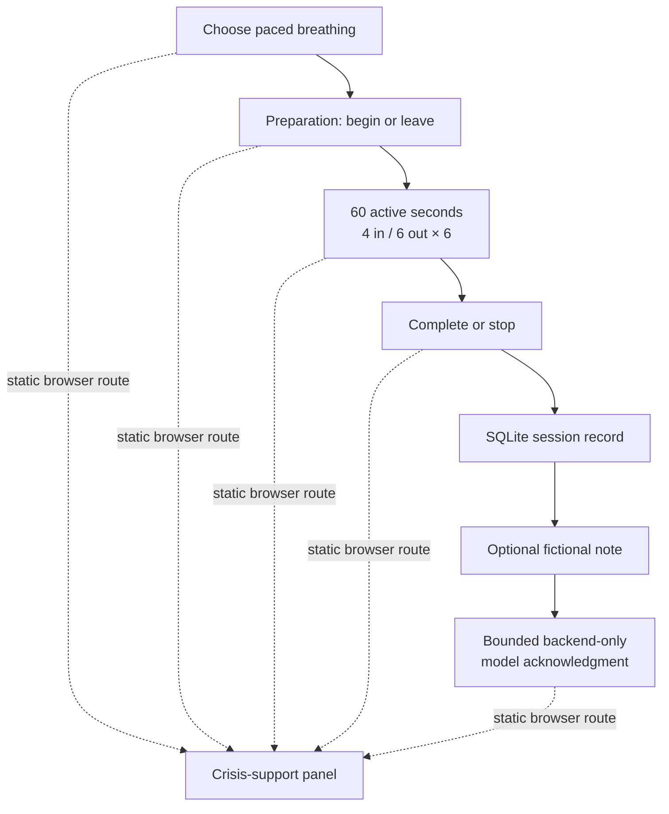

# Stillpoint design and safety note — Assignment 3.2

## Implemented experience

Part 3.2 implements one coherent study-provided skill: **paced breathing (4–6)**. The person chooses the practice, sees a quiet preparation screen, then follows six visual/text cycles of four seconds in and six seconds out. A pause control stops active timing; an end/leave control is present before and during the exercise. Completion is never required.

The proposed 5–4–3–2–1 grounding design from Part 3.1 is intentionally deferred. It is not shown as an available skill, so the running interface does not claim to support it.

## Research grounding and tradeoffs

| Finding | Implemented decision | Tradeoff |
| --- | --- | --- |
| R1: attention fell after 90–100 seconds; ~60 seconds felt comfortable (38 mentions) | Six 4+6 cycles take 60 active seconds, measured from the first “Breathe in” cue through the final cycle. Setup precedes the measurement; a voluntary pause is excluded. | A single short practice respects attention but offers less variety. |
| R2: frictionless crisis access (30) and D4: persistent safety (31) | A fixed Vue button opens static support information; it does not request FastAPI or rely on a model/classifier decision. | The U.S.-specific resource must be checked when updated; the app itself does not provide crisis care. |
| R3: permission to stop (39) and R4: user control (68) | Preparation and active practice each offer leave/end controls without confirmation or explanation. History records stopping as a neutral outcome. | The session may be brief, by design. |
| D1: progressive contraction (54) | The prototype does not infer distress. It gives everyone a low-stimulus baseline: one practice, one primary action, short text, and no in-practice dashboard. | It cannot claim personalized contraction. |
| D2: one atomic skill at a time (100) and D3: minimize emotional cost (148) | The active screen provides only the count/cue plus pause/end controls. No disclosure, rating, or written response is needed to finish. | It collects less individual context. |
| D5: personalization without configuration burden (49) | The latest completed practice is offered as an optional repeat shortcut, not an automatic route. | It remembers only one lightweight signal instead of a preference profile. |
| D6: low-stimulus, non-judgmental language (97) | Muted colors, restrained motion, native keyboard controls, and `prefers-reduced-motion` support keep the cue readable without clinical or cheerful pressure. | The visual treatment is intentionally simple. |

## Safety and model boundaries

The model is optional and backend-only. After a **completed** session, someone may submit a short fictional note. FastAPI sends only the skill identifier, completion state, and that note to request one neutral acknowledgment under 120 characters. The application rejects replies that are too long or include diagnostic, therapeutic, medical, crisis, or directive language and replaces them with a fixed local response.

The model cannot change the breathing sequence, operate the timer, select a skill, prevent an exit, write SQLite directly, or provide the crisis route. The frontend catches provider/configuration failures and leaves the completed practice intact. A narrow local phrase check prevents limited potential-crisis text from being saved or transmitted; it creates only a generic safety event. This check is not a distress detector: it can miss wording and over-match fictional text.

## Persistent records

`skill_sessions` stores an opaque ID, `paced_breathing`, source (`chosen` or `usual_skill`), outcome (`active`, `completed`, or `stopped`), active seconds, and timestamps. `conversation_messages` stores an explicit optional fictional note, bounded assistant response/model identifier, or generic safety-handling marker. The history view displays the newest 12 sessions and 24 messages. There is no account, score, diagnosis, location, inferred distress level, or stored potential-crisis text.

## Observed timing and scope change

In the October 15 browser check, a full practice completed with **60 active seconds**. A leave-before-begin path recorded `stopped` with **0 seconds** and appeared in history. The model successfully returned a bounded acknowledgment for a fictional note. On October 29, the current build was rechecked: navigating from an active practice to Saved history first recorded a neutral stopped session, and a separately key-disabled local API returned HTTP 503 for the companion without making a model call. Details are in [the verification record](assignment3-verification.md).

Part 3.2 does not yet include 5–4–3–2–1 grounding, the 15-scenario evaluation, peer testing, or the Part 3.3 process screencast.
